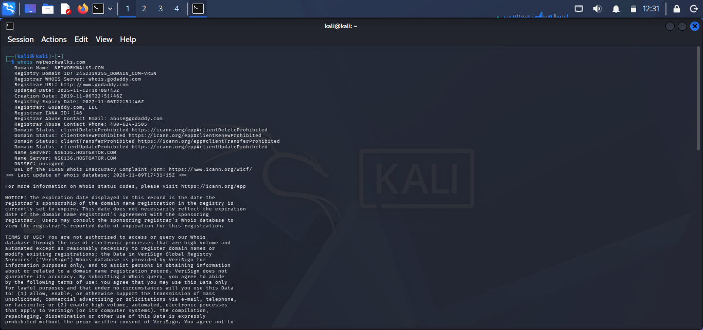
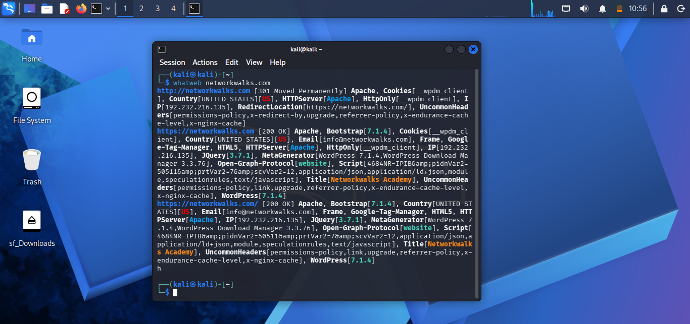
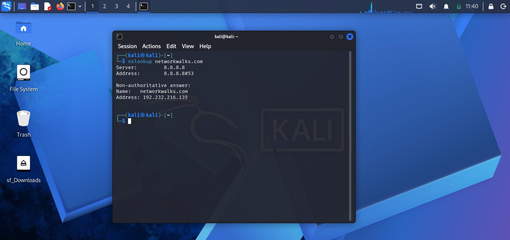
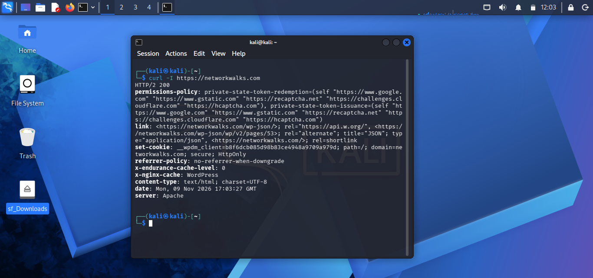
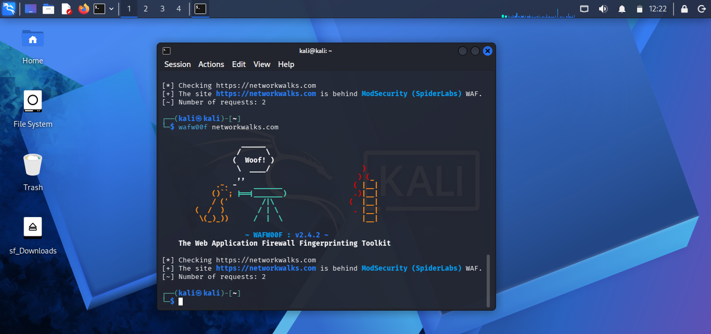
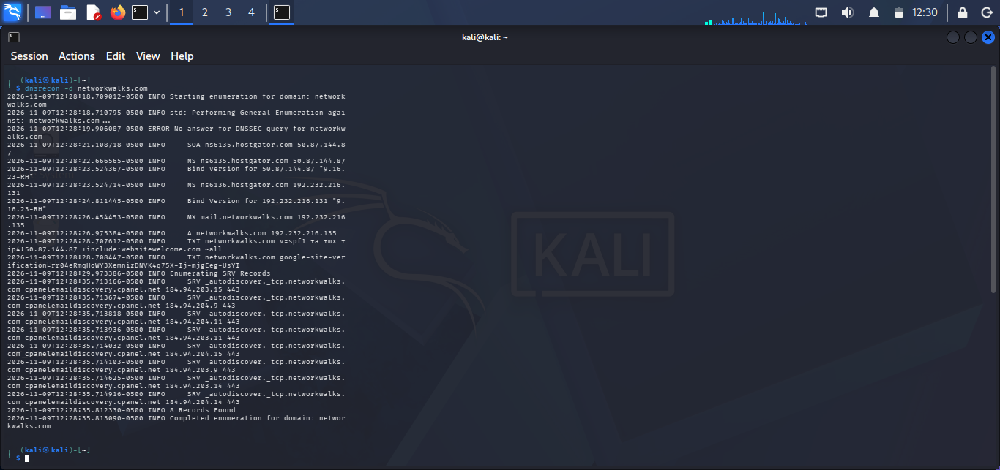

# NETWORKWALKS-B084C-WEEK2-CYBERSECURITY-LAB-WP2
Completed The Second week project in NetworkWalks.
# WEEK 2 SECURITY ASSESSMENT REPORT
## RECONNAISSANCE, FOOTPRINTING & NETWORK SCANNING

---

## 1. PROJECT OVERVIEW

This repository contains the practical work completed as part of the NetworkWalks Cybersecurity Internship.

The project focuses on reconnaissance, footprinting, network scanning, and host discovery.

### Project Details

| Field | Details |
|---|---|
| Name | YOGESHWARAN S |
| Batch | B084C |
| Internship | NetworkWalks |
| Project | Week 2 Security Assessment |
| Phase 1 | Reconnaissance and Footprinting |
| Phase 2 | Scanning and Network Discovery |
| Date | 13 November 2026 |

---

## 2. LEGAL NOTICE

All activities documented in this repository were performed for educational and internship purposes.

Scanning was conducted only within the authorized lab environment. No unauthorized access or exploitation was attempted.

---

## 3. TOOLS USED

- Kali Linux
- VirtualBox
- WHOIS
- WhatWeb
- Nslookup
- cURL
- Wafw00f
- DNSRecon
- Zenmap
- Nmap
- Windows Command Prompt

---

## 4. WORK CARRIED OUT

### 4.1 W2-PM1: RECONNAISSANCE AND FOOTPRINTING

**Objective:**

To collect publicly available information about the target domain using reconnaissance and footprinting tools.

**Tools and Commands:**

**1. WHOIS**

```bash
whois networkwalks.com
```

Purpose: To collect domain registration information.

**2. WhatWeb**

```bash
whatweb https://networkwalks.com
```

Purpose: To identify technologies used by the website.

**3. Nslookup**

```bash
nslookup networkwalks.com
```

Purpose: To identify the IP address associated with the domain.

**4. cURL**

```bash
curl -I https://networkwalks.com
```

Purpose: To inspect HTTP response headers.

**5. Wafw00f**

```bash
wafw00f https://networkwalks.com
```

Purpose: To check whether a Web Application Firewall is detected.

**6. DNSRecon**

```bash
dnsrecon -d networkwalks.com
```

Purpose: To collect DNS-related information.

**Results:**
## 4.1 W2-PM1: RECONNAISSANCE AND FOOTPRINTING

### Evidence 1: WHOIS Output


### Evidence 2: WhatWeb Output


### Evidence 3: Nslookup Output


### Evidence 4: cURL Output


### Evidence 5: Wafw00f Output


### Evidence 6: DNSRecon Output


---
## 🗺️ 4.2 W2-PM5: Network Scanning with Zenmap

I performed a Ping Scan on my own local Wi-Fi network using Zenmap.

### Local Network Configuration

| Detail | Result |
|---|---|
| Local IPv4 Address | 10.55.89.122 |
| Subnet Mask | 255.255.255.0 |
| Default Gateway | 10.55.89.87 |
| LAN Subnet | 10.55.89.0/24 |

### Live Hosts Discovered

Zenmap identified 2 live hosts.

| No. | IP Address | Device |
|---|---|---|
| 1 | 10.55.89.87 | Gateway |
| 2 | 10.55.89.122 | My Laptop |

### MAC Address Details

| IP Address | MAC Address |
|---|---|
| 10.55.89.87 | 4A:4B:C2:B4:D4:14 |
| 10.55.89.122 | 58-E4-EB-C5-E4-AA |

The gateway MAC address was displayed with
the vendor name as Unknown in Zenmap.

### Scan Summary

256 IP addresses were scanned.
2 hosts were found up.

### Topology

I opened the Topology tab in Zenmap,
enabled the Legend and exported the
network topology as a PDF.

### Results


### Practice Lab Result

Successfully completed the Zenmap practice
lab with a score of 100% on re-attempt.


## 10. AUTHOR DETAILS

**Name:** YOGESHWARAN S

**Batch:** B084C

**GitHub:** https://github.com/YOGESHcyber/INFOZATECH

**LinkedIn:** https://www.linkedin.com/in/yogeshwaran-s-1b2038386/

**Internship:** NetworkWalks

---
